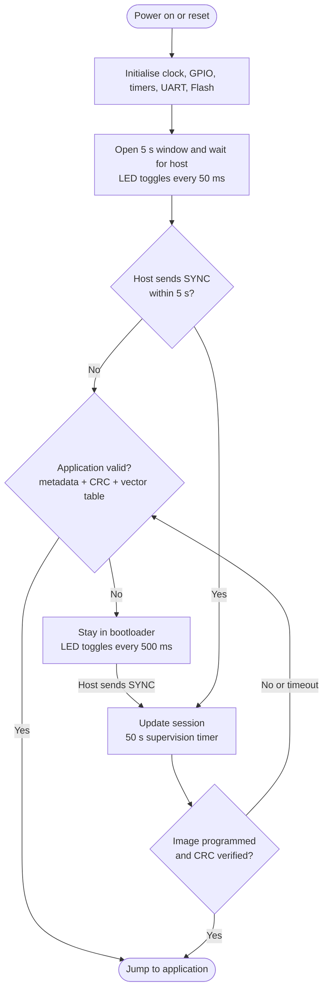
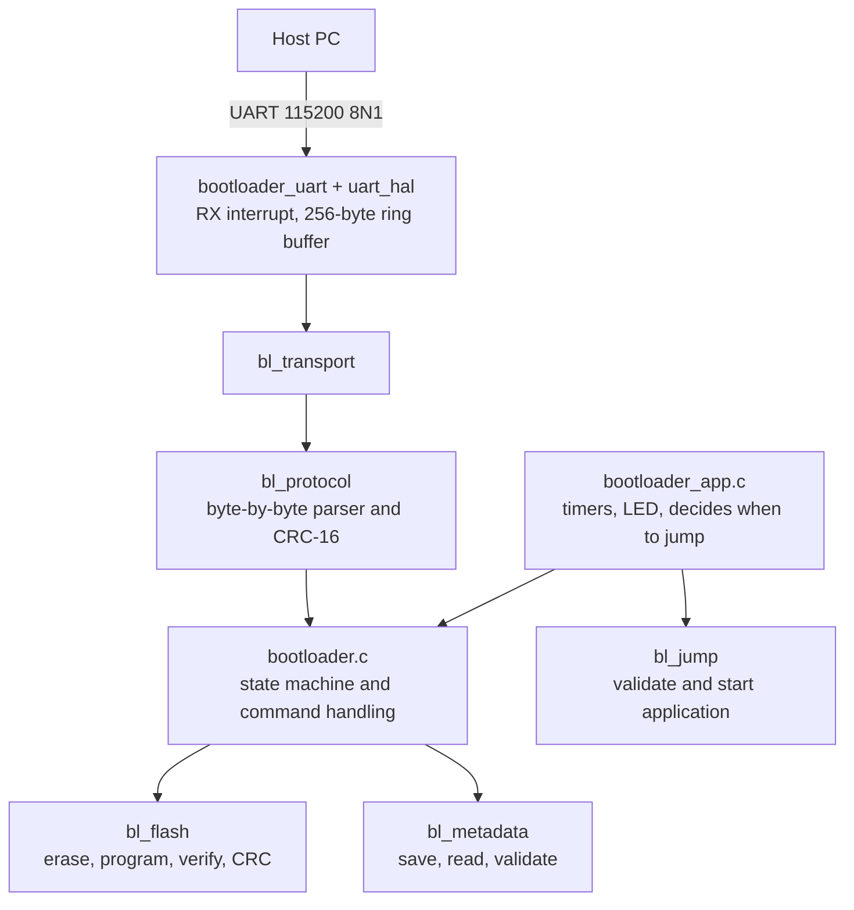
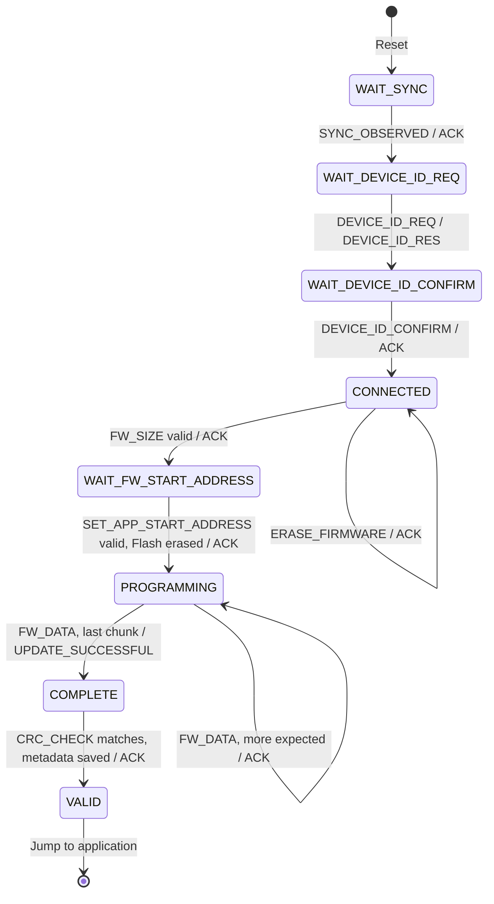
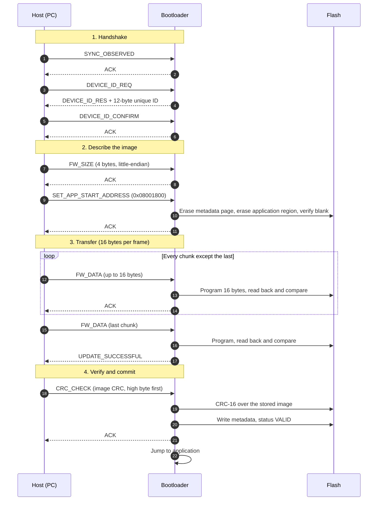

<div align="center">

# STM32G030F6P6 UART Bootloader

**A small, safety-first UART bootloader for the STM32G030F6P6 (Cortex-M0+, 32 KB Flash).**
It receives a firmware image over a serial line, programs it, proves it is intact with CRC-16, and only then lets it run, all inside 6 KB.


</div>

---

## Table of Contents

1. [Overview](#overview)
2. [At a Glance](#at-a-glance)
3. [Features](#features)
4. [How It Works in One Minute](#how-it-works-in-one-minute)
5. [Flash Memory Layout](#flash-memory-layout)
6. [Firmware Metadata](#firmware-metadata)
7. [Startup Behaviour and Timeouts](#startup-behaviour-and-timeouts)
8. [UART Protocol](#uart-protocol)
9. [Bootloader State Machine](#bootloader-state-machine)
10. [Firmware Update Walk-through](#firmware-update-walk-through)
11. [Flash Handling](#flash-handling)
12. [Application Handover](#application-handover)
13. [Host GUI Updater](#host-gui-updater)
14. [Writing Your Own Host Tool](#writing-your-own-host-tool)
15. [Main Application Linker Configuration](#main-application-linker-configuration)
16. [Project Structure](#project-structure)
17. [Build Instructions](#build-instructions)
18. [Programming and Testing](#programming-and-testing)
19. [Troubleshooting](#troubleshooting)
20. [Things to Know](#things-to-know)
21. [Project Status](#project-status)
22. [Author](#author)

---

## Overview

A bootloader is the first program that runs after reset. This one has two jobs:

1. **Update:** accept a new application image from a PC over UART and store it in Flash.
2. **Start:** run the stored application, but only if it is complete and uncorrupted.

The 32 KB Flash is split into three regions: the **bootloader** itself, the **main application**, and a small **metadata** page that records whether the application can be trusted. The application is marked valid only after it has been fully programmed, read back, and checked against a CRC-16. A failed or interrupted update therefore never boots a half-written image, and the bootloader code is never touched by a UART update.

## At a Glance

| Item | Value |
|---|---|
| MCU | STM32G030F6P6 (Cortex-M0+, 64 MHz max, 32 KB Flash, 8 KB SRAM, 2 KB Flash pages) |
| Link | USART1, **TX = PB6**, **RX = PB7**, 115200 baud, 8N1, no flow control |
| RX path | Interrupt driven, 256-byte ring buffer |
| TX path | TX interrupt and DMA are disabled in the board configuration |
| Status LED | PA0 |
| Wait for host after reset | 5 s |
| Update supervision timer | 50 s |
| Frame size | 6 to 22 bytes (up to 16 data bytes per frame) |
| Frame integrity | CRC-16/CCITT-FALSE (poly `0x1021`, init `0xFFFF`) |
| Image integrity | Same CRC-16, computed over the real image size |
| Device ID | 96-bit unique ID (12 bytes) read from `0x1FFF7590` |
| Host tool | [Universal Firmware Updater](#host-gui-updater) (PC GUI). Application address `0x08001800`, chunk size 16 |
| Build | CMake + Ninja, ARM GNU toolchain |

All pins, timings and the UART instance live in `BSP/board_bootloader.h`.

## Features

- Custom bootloader for STM32G030F6P6, 6 KB footprint
- UART firmware update with a framed, CRC-protected protocol
- ACK / NACK replies with error codes, plus a retry limit
- Device ID handshake so the host can confirm which chip it is talking to
- Firmware size and start-address validation **before** anything is erased
- Page erase with erase verification
- Flash programming with read-back verification
- Whole-image CRC-16 check
- Dedicated metadata page, written last
- Application vector-table and reset-handler validation
- Automatic start of a valid application, no host needed
- LED status patterns
- Flash driver refuses any write or erase outside its allowed region, which protects the bootloader
- CMake build, no STM32CubeMX required

## How It Works in One Minute



The idea behind the safety is simple. When an update starts, the old metadata and the old application are erased first. The metadata is written again, with status `VALID`, only as the very last step, after every byte has been programmed, read back, and matched against the CRC the host sent. If power fails or the cable is unplugged halfway, the metadata page stays blank, so the next boot sees "no valid application" and waits for a new update instead of running garbage.

Layers of the code, from the wire to the Flash:



## Flash Memory Layout

The 32 KB Flash is 16 pages of 2 KB.

| Region | Start | End | Size | Pages |
|---|---|---|---:|---|
| Bootloader | `0x08000000` | `0x080017FF` | 6 KB | 0 to 2 |
| Main Application | `0x08001800` | `0x080077FF` | 24 KB | 3 to 14 |
| Firmware Metadata | `0x08007800` | `0x08007FFF` | 2 KB | 15 |

```text
0x08000000 +---------------------------+
           |        Bootloader         |  6 KB   (pages 0-2)
0x08001800 +---------------------------+
           |                           |
           |     Main Application      |  24 KB  (pages 3-14)
           |  vector table at 0x08001800
           |                           |
0x08007800 +---------------------------+
           |     Firmware Metadata     |  2 KB   (page 15)
0x08008000 +---------------------------+
```

> **Important:** the bootloader occupies the first 6 KB. The last 2 KB page is reserved for metadata. The main application must never overwrite either region.

The addresses come from `Bootloader/config/bl_flash_config.h`:

```c
#define BL_BOOTLOADER_START_ADDRESS  (0x08000000UL)   /* 6 KB  */
#define BL_APP_START_ADDRESS         (0x08001800UL)   /* 24 KB */
#define BL_METADATA_START_ADDRESS    (0x08007800UL)   /* 2 KB  */
```

## Firmware Metadata

The metadata is one 32-byte record stored at the start of the metadata page. It tells the bootloader what is installed and whether it is trustworthy.

```c
typedef struct
{
    uint32_t magic;          /* 0x424C4D44 ("BLMD") marks a real record          */
    uint32_t start_address;  /* where the application lives                      */
    uint32_t size;           /* real image size in bytes (no padding)            */
    uint16_t crc;            /* CRC-16/CCITT-FALSE of the image                  */
    uint16_t version;        /* reserved, not filled in by the update flow yet   */
    uint32_t update_status;  /* 0xA5A5A5A5 = VALID                               */
    uint32_t reserved[3];
} BL_FirmwareMetadata_t;
```

```c
#define BL_FIRMWARE_METADATA_MAGIC  (0x424C4D44UL)
#define BL_UPDATE_STATUS_INVALID    (0x00000000UL)
#define BL_UPDATE_STATUS_VALID      (0xA5A5A5A5UL)
#define BL_FLASH_CRC16_POLYNOMIAL   (0x1021U)
#define BL_FLASH_CRC16_INITIAL      (0xFFFFU)
```

**An application counts as valid only when all of these are true:**

1. `magic` equals `0x424C4D44`
2. `start_address` is inside the application region and `size` is non-zero and fits
3. `update_status` equals `0xA5A5A5A5`
4. The CRC-16 calculated over `size` bytes of Flash from `start_address` equals the stored `crc`

**"Invalid" is represented by an erased page.** Erased Flash reads `0xFFFFFFFF`, so the magic does not match and check 1 fails. The update flow erases the metadata page at the start of every update and writes the `VALID` record last. (`BL_UPDATE_STATUS_INVALID` is defined but the current update flow does not write it.)

## Startup Behaviour and Timeouts

The bootloader always runs first after reset. It never jumps straight to the application.

| Moment | What happens |
|---|---|
| Reset | Initialise hardware, start a **5 s** window, LED toggles every **50 ms** |
| No host in 5 s, valid app | Validate and **jump to the application** |
| No host in 5 s, no valid app | Stay in the bootloader indefinitely, LED toggles every **500 ms**, wait for a host |
| Host connected | A **50 s** supervision timer is armed for the update |
| Update completes (CRC verified) | **Jump immediately**, no waiting |
| 50 s expires, update not finished | If an application is still valid, jump to it. Otherwise return to idle and wait again |

A valid application is therefore started about 5 s after reset unless a host connects. The host must send `SYNC_OBSERVED` inside that 5 s window (keep sending it while resetting the board).

If a host connects but never starts an update, the old application is still valid, so it is started when the 50 s timer expires.

**LED patterns (PA0):**

| Situation | LED |
|---|---|
| Waiting for a host (first 5 s) | Toggles every 50 ms |
| Waiting with no valid application | Toggles every 500 ms |
| Host connected, ready | Solid on |
| Programming | Toggles every 20 ms |

## UART Protocol

### Physical layer

USART1, 115200 baud, 8 data bits, no parity, 1 stop bit. PB6 is the bootloader's TX, PB7 is its RX. Use a 3.3 V USB-UART adapter, with TX and RX crossed.

### Frame format

```text
+------+--------+------+---------+------------+----------+
| SOF  | LENGTH | TYPE | COMMAND | DATA       | CRC-16   |
| 1 B  | 1 B    | 1 B  | 1 B     | 0..16 B    | 2 B      |
+------+--------+------+---------+------------+----------+
```

| Field | Size | Meaning |
|---|---|---|
| `SOF` | 1 | Always `0xA5`. The parser skips bytes until it sees it, so it can resynchronise after noise. |
| `LENGTH` | 1 | Number of bytes in `TYPE + COMMAND + DATA`. Range 2 to 18. |
| `TYPE` | 1 | `0x01` command, `0x02` data. See the note below. |
| `COMMAND` | 1 | What to do (see the command table). |
| `DATA` | 0 to 16 | Command payload. |
| `CRC-16` | 2 | CRC-16/CCITT-FALSE, sent **high byte first**. |

Frame size is `4 + LENGTH`, so a frame is 6 bytes (no data) up to 22 bytes (16 data bytes).

**The CRC covers `LENGTH`, `TYPE`, `COMMAND` and `DATA`. It does not include `SOF`.**

CRC-16/CCITT-FALSE means polynomial `0x1021`, initial value `0xFFFF`, no bit reflection, no final XOR. A quick check value: the CRC of the ASCII string `123456789` is `0x29B1`.

> **About `TYPE`:** the bootloader decides what to do from the `COMMAND` byte only and currently does not check `TYPE`. Its own replies always use `TYPE = 0x01`. The host GUI sends `0x01` for commands and `0x02` for `FW_DATA` frames; follow the same convention.

**Byte order of payloads:** `FW_SIZE` and `SET_APP_START_ADDRESS` carry a 32-bit value in **little-endian** order. `CRC_CHECK` carries a 16-bit CRC in **big-endian** order (high byte first), the same as the frame CRC.

### Example frames

These were generated with the repository's own frame builder, so they are exact.

| Frame | Bytes |
|---|---|
| `SYNC_OBSERVED` | `A5 02 01 20 B5 AF` |
| `ACK` | `A5 02 01 15 D3 59` |
| `DEVICE_ID_REQ` | `A5 02 01 3C 66 12` |
| `DEVICE_ID_CONFIRM` | `A5 02 01 3D 76 33` |
| `FW_SIZE` = 4096 | `A5 06 01 42 00 10 00 00 03 C3` |
| `SET_APP_START_ADDRESS` = `0x08001800` | `A5 06 01 4A 00 18 00 08 29 47` |
| `CRC_CHECK` with CRC `0x1234` (illustrative) | `A5 04 01 3B 12 34 C8 2C` |
| `NACK` with error `0x01` (CRC) | `A5 03 01 59 01 8C 2A` |

Reading `FW_SIZE`: `A5` start, `06` length (type + command + 4 data bytes), `01` command type, `42` command, `00 10 00 00` = 0x00001000 little-endian = 4096, `03 C3` CRC.

### Command set

```c
typedef enum
{
    BL_CMD_NONE                  = 0x00U,
    BL_CMD_SYNC_OBSERVED         = 0x20U,
    BL_CMD_DEVICE_ID_REQ         = 0x3CU,
    BL_CMD_DEVICE_ID_RES         = 0x3FU,
    BL_CMD_DEVICE_ID_CONFIRM     = 0x3DU,
    BL_CMD_FW_SIZE               = 0x42U,
    BL_CMD_SET_APP_START_ADDRESS = 0x4AU,
    BL_CMD_FW_DATA               = 0x50U,
    BL_CMD_UPDATE_SUCCESSFUL     = 0x54U,
    BL_CMD_ACK                   = 0x15U,
    BL_CMD_NACK                  = 0x59U,
    BL_CMD_RETX                  = 0x19U,
    BL_CMD_CRC_CHECK             = 0x3BU,
    BL_CMD_ERASE_FIRMWARE        = 0x60U,
} BL_Command_t;
```

| Command | ID | Direction | Payload | Accepted in state | Reply |
|---|---|---|---|---|---|
| `SYNC_OBSERVED` | `0x20` | Host to MCU | none | `WAIT_SYNC` | `ACK` |
| `DEVICE_ID_REQ` | `0x3C` | Host to MCU | none | `WAIT_DEVICE_ID_REQ` | `DEVICE_ID_RES` |
| `DEVICE_ID_RES` | `0x3F` | MCU to Host | 12-byte unique ID | n/a | n/a |
| `DEVICE_ID_CONFIRM` | `0x3D` | Host to MCU | none | `WAIT_DEVICE_ID_CONFIRM` | `ACK` |
| `ERASE_FIRMWARE` | `0x60` | Host to MCU | none | `CONNECTED` | `ACK` |
| `FW_SIZE` | `0x42` | Host to MCU | 4 B, image size, little-endian | `CONNECTED` | `ACK` |
| `SET_APP_START_ADDRESS` | `0x4A` | Host to MCU | 4 B, address, little-endian | `WAIT_FW_START_ADDRESS` | `ACK` (after erasing) |
| `FW_DATA` | `0x50` | Host to MCU | 1 to 16 B of firmware | `PROGRAMMING` | `ACK`, or `UPDATE_SUCCESSFUL` on the last chunk |
| `UPDATE_SUCCESSFUL` | `0x54` | MCU to Host | none | n/a | Sent instead of the last `ACK` |
| `CRC_CHECK` | `0x3B` | Host to MCU | 2 B, image CRC, big-endian | `COMPLETE` | `ACK` |
| `ACK` | `0x15` | MCU to Host | none | n/a | Command accepted |
| `NACK` | `0x59` | MCU to Host | 1 B error code | n/a | Command rejected |
| `RETX` | `0x19` | Host to MCU | none | any state (see note) | Replays the target's last handshake reply |

> **`UPDATE_SUCCESSFUL` does not mean the application is ready.** It means every byte has been received and written. The image is trusted, and the metadata is written, only after the host sends `CRC_CHECK` and the CRC matches.

> **`RETX`:** the bootloader remembers the last handshake packet it handled (`SYNC_OBSERVED`, `DEVICE_ID_REQ`, `FW_SIZE`, `SET_APP_START_ADDRESS`). When the host sends `RETX`, it restores the state it had before that packet and processes it again, which re-sends the reply. Use it only during the handshake when a reply was lost. **Do not send `RETX` during `FW_DATA` transfer**: the last remembered packet is then `SET_APP_START_ADDRESS`, and replaying it would erase the Flash again. During data transfer, simply resend the same `FW_DATA` frame. If nothing is remembered, the reply is `NACK` with `NO_RETRY_PACKET`.

### Error codes (the payload of `NACK`)

| Code | Name | Typical cause |
|---|---|---|
| `0x00` | `BL_ERROR_NONE` | No error |
| `0x01` | `BL_ERROR_CRC` | Frame CRC wrong, or image CRC mismatch on `CRC_CHECK` |
| `0x02` | `BL_ERROR_LENGTH` | Payload has the wrong size (4 bytes expected for size and address, 2 for CRC) |
| `0x03` | `BL_ERROR_COMMAND` | Unknown command ID (including `0x00`) |
| `0x04` | `BL_ERROR_STATE` | Command sent in the wrong state or out of order |
| `0x05` | `BL_ERROR_ADDRESS` | Start address outside the application region |
| `0x06` | `BL_ERROR_SIZE` | Size is 0, too big, or does not fit from the start address |
| `0x07` | `BL_ERROR_PROTOCOL` | Malformed frame (for example `LENGTH` out of range) |
| `0x08` | `BL_ERROR_DEVICE_ID` | Defined, not sent by the current code |
| `0x09` | `BL_ERROR_NO_RETRY_PACKET` | `RETX` received but nothing to replay |
| `0x0A` | `BL_ERROR_FLASH_ERASE` | Erase failed, or the region was not blank after erase |
| `0x0B` | `BL_ERROR_DATA` | Bad `FW_DATA` (empty, more than expected, program or verify failed) or metadata save failed |

## Bootloader State Machine



Any state can also fall back to `WAIT_SYNC`; the rules are in [Error handling](#error-handling) below.

### States

| State | Meaning |
|---|---|
| `WAIT_SYNC` | Idle. Waiting for the host to say hello. Also the state after any serious error. |
| `WAIT_DEVICE_ID_REQ` | Hello received. Waiting for the host to ask for the device ID. |
| `WAIT_DEVICE_ID_CONFIRM` | ID sent. Waiting for the host to confirm. |
| `CONNECTED` | Handshake done. Accepts `ERASE_FIRMWARE` and `FW_SIZE`. |
| `WAIT_FW_START_ADDRESS` | Size accepted. Waiting for the application start address. |
| `PROGRAMMING` | Flash is erased. Receiving and writing firmware chunks. |
| `COMPLETE` | Every byte received. Waiting for `CRC_CHECK`. |
| `VALID` | CRC matched and metadata is saved. The main loop jumps to the application. |

The state enum in `bootloader.h` also lists `WAIT_FW_LENGTH`, `READY` and `RECEIVING`. They are declared but not used by the current command handling.

### Transition table

| Current state | Command received | What the bootloader does | Reply | Next state |
|---|---|---|---|---|
| `WAIT_SYNC` | `SYNC_OBSERVED` | Remember the packet for `RETX` | `ACK` | `WAIT_DEVICE_ID_REQ` |
| `WAIT_DEVICE_ID_REQ` | `DEVICE_ID_REQ` | Read the 12-byte unique ID | `DEVICE_ID_RES` + ID | `WAIT_DEVICE_ID_CONFIRM` |
| `WAIT_DEVICE_ID_CONFIRM` | `DEVICE_ID_CONFIRM` | Nothing | `ACK` | `CONNECTED` |
| `CONNECTED` | `ERASE_FIRMWARE` | Erase metadata page and application region, check both are blank | `ACK` | `CONNECTED` |
| `CONNECTED` | `FW_SIZE` | Check `0 < size <= 24 KB`, store it | `ACK` | `WAIT_FW_START_ADDRESS` |
| `WAIT_FW_START_ADDRESS` | `SET_APP_START_ADDRESS` | Check address and that the image fits. **Erase metadata, then erase the whole application region**, verify both are blank | `ACK` | `PROGRAMMING` |
| `PROGRAMMING` | `FW_DATA` (not last) | Pad to 16 bytes with `0xFF`, program, read back, advance 16 bytes | `ACK` | `PROGRAMMING` |
| `PROGRAMMING` | `FW_DATA` (last) | Same, and the received byte count now equals the image size | `UPDATE_SUCCESSFUL` | `COMPLETE` |
| `COMPLETE` | `CRC_CHECK` | CRC-16 over the Flash image, compare with the host's value. On match, write the metadata with `VALID` | `ACK` | `VALID` |

### Error handling

Errors fall into three groups.

**1. Command in the wrong state.** The bootloader replies `NACK` with `BL_ERROR_STATE`.
For `SYNC_OBSERVED` (when not idle), `FW_SIZE`, `SET_APP_START_ADDRESS`, `FW_DATA` and `CRC_CHECK` it also returns to `WAIT_SYNC`, so the host restarts from `SYNC`.
For `DEVICE_ID_REQ`, `DEVICE_ID_CONFIRM` and `ERASE_FIRMWARE` it replies `NACK` and keeps the current state.

**2. A bad value.** An invalid image size or start address gets `NACK` (`BL_ERROR_SIZE` or `BL_ERROR_ADDRESS`) and the state returns to `WAIT_SYNC`.

**3. A recoverable error.** Corrupt frame (CRC), bad `LENGTH`, unknown command, wrong payload length, Flash erase/program/verify failure, or an image CRC mismatch. The bootloader replies `NACK` with the reason and **stays in the same state**, so the host can resend the same packet. A counter tracks consecutive failures: after **10 in a row** the bootloader gives up and returns to `WAIT_SYNC`. Every successful `ACK` resets the counter.

## Firmware Update Walk-through



**Step by step** (the [Host GUI Updater](#host-gui-updater) performs all of these for you)

1. **Sync.** Send `SYNC_OBSERVED` within 5 s of reset. The bootloader answers `ACK`.
2. **Identify.** Send `DEVICE_ID_REQ`. The reply carries the chip's 12-byte unique ID. The host should check it is the board it expects, then send `DEVICE_ID_CONFIRM`. (The bootloader does not compare the ID itself; the check is the host's job.)
3. **Erase (optional).** `ERASE_FIRMWARE` can be sent from `CONNECTED` to wipe the metadata and application early. A normal update does not need it, because the erase also happens in step 5.
4. **Size.** Send `FW_SIZE` with the image length in bytes (little-endian).
5. **Address.** Send `SET_APP_START_ADDRESS`. Use `0x08001800`. The bootloader erases the metadata page and all 12 application pages here, which can take a few hundred milliseconds, so give this reply a generous host timeout (a few seconds).
6. **Data.** Send the image in 16-byte `FW_DATA` frames, waiting for `ACK` after each. On `NACK` with `BL_ERROR_CRC`, resend the same frame. The final frame is answered with `UPDATE_SUCCESSFUL` instead of `ACK`.
7. **Commit.** Send `CRC_CHECK` with the CRC-16 of the image. On a match the bootloader saves the metadata and replies `ACK`, then jumps to the new application.

**Timing.** The whole update has to finish inside the 50 s supervision timer. At 115200 baud a 24 KB image needs roughly 4 to 5 s of wire time (an estimate), so there is plenty of margin, even allowing for host-side latency.

## Flash Handling

The Flash driver (`Bootloader/flash/bl_flash.c`) works directly on the Flash registers.

| Operation | Behaviour |
|---|---|
| Erase | Page by page (2 KB). Each page waits for the busy flag, checks error flags, and is verified blank afterwards by the caller. |
| Program | STM32G0 programs **64 bits (8 bytes) at a time**. Each firmware chunk is written as 16 bytes, which is two double-words. Address and length must be 8-byte aligned. |
| Padding | A chunk shorter than 16 bytes is padded with `0xFF` before writing. |
| Read-back | Every double-word is compared after it is written, and the whole 16-byte chunk is compared again by the core. |
| CRC | Computed straight from Flash, byte by byte, over the real image size only (not the padding). |
| Timeouts | Waiting for the Flash busy flag has a loop limit so a stuck operation cannot hang the bootloader forever. |

**Range protection.** The application functions (`BL_Flash_Erase`, `BL_Flash_Write`, ...) accept only addresses inside `0x08001800` to `0x080077FF`. The `_MetaData` functions accept only the metadata page. Nothing in the UART path can erase or write the bootloader pages.

## Application Handover

`BL_Jump_IsApplicationValid()` checks the application's vector table, then `BL_Jump_ToApplication()` starts it.

**Checks** (the vector table is read at `0x08001800`):

1. The initial stack pointer is inside SRAM (`0x20000000` to `0x20002000`) and 8-byte aligned.
2. The reset handler address has the Thumb bit (bit 0) set.
3. The reset handler address, with the Thumb bit removed, is inside the application region.

**Jump sequence:**

1. Flush with `DSB` and `ISB`.
2. Stop SysTick.
3. Disable and clear every NVIC interrupt.
4. Set `SCB->VTOR` to `0x08001800`, so interrupts use the application's vector table.
5. Load the application's stack pointer into `MSP` and branch to its reset handler, all in one assembly sequence that never returns.

Before jumping, the bootloader releases its timers and GPIO (`Bootloader_App_Deinit`). The application should initialise the peripherals it needs.

## Host GUI Updater

The companion PC application is **[Universal Firmware Updater](https://github.com/shohanur00/Universal_Firmware_Updater)**, a desktop GUI (Python with PySide6 and pyserial, Windows) that speaks this bootloader's protocol. The repository also ships a prebuilt `Universal_Firmware_Updater.exe` in its `dist/` folder.

> **Two settings must be changed for this bootloader.** The GUI starts with **Application Address = `0x08004000`**, which belongs to a different memory map. Set it to **`0x08001800`**. Keep **Chunk Size = 16**.

### Settings for the STM32G030 bootloader

| GUI field | Value | Why |
|---|---|---|
| **COM Port** | The USB-UART adapter's port (for example `COM7`) | The box is editable, so any port name can be typed |
| **Baud Rate** | `115200` | Must match the bootloader (`BOOTLOADER_UART_BAUDRATE`) |
| **Firmware File** | A `.bin` built for `0x08001800` | The GUI only accepts `.bin` files, not `.elf` or `.hex` |
| **Application Address** | **`0x08001800`** | Start of the application region. The GUI default is `0x08004000`, which this bootloader rejects with `NACK 0x05` |
| **Chunk Size** | **`16`** (the GUI default) | The GUI also offers 4 and 8, but this bootloader programs and advances 16 bytes per frame. A shorter chunk leaves `0xFF` gaps in Flash and the final CRC check fails |

The address is typed with the `0x` prefix. The GUI does not remember it between runs, so enter it each time.

### Step by step

1. Build the application with its flash origin at `0x08001800` and produce a `.bin` (see [Main Application Linker Configuration](#main-application-linker-configuration)).
2. Start the GUI: run `Universal_Firmware_Updater.exe`, or from source:
   ```bash
   git clone https://github.com/shohanur00/Universal_Firmware_Updater
   cd Universal_Firmware_Updater
   pip install PySide6 pyserial
   python launcher.py
   ```
3. Choose the COM port, set the baud rate to `115200`, click **Browse** and pick the `.bin`, then set **Application Address** to `0x08001800` and **Chunk Size** to `16`. Do this **before** connecting.
4. Click **Connect**, then **reset or power-cycle the board**. The GUI retries the handshake up to 30 times, roughly one attempt per second, until the bootloader answers. The bootloader listens for a host during the first 5 s after reset, so the reset must happen while the GUI is retrying. When the handshake succeeds the status shows **CONNECTED** and the log prints the 12-byte device ID.
5. Click **Update Firmware** within about **50 s** of connecting (the bootloader's supervision timer). Check the confirmation dialog shows `Application address: 0x08001800` and `Chunk size: 16 bytes`, then click **Yes**.
6. Wait for the progress bar to reach 100 %. Do not remove power while it runs.
7. A success dialog appears and the bootloader starts the new application immediately.

### What the GUI does on the wire

| GUI action | Protocol messages | Progress |
|---|---|---|
| **Connect** | `SYNC_OBSERVED` → `ACK`, `DEVICE_ID_REQ` → `DEVICE_ID_RES`, `DEVICE_ID_CONFIRM` → `ACK` | n/a |
| **Update Firmware** | The device ID from the handshake is reused (not requested again) | 10 % |
| | `FW_SIZE` → `ACK` | 15 % |
| | `SET_APP_START_ADDRESS` → `ACK` (the bootloader erases metadata and application here, the GUI waits up to 10 s) | 20 % |
| | `FW_DATA` × N (the last frame is answered with `UPDATE_SUCCESSFUL`) | 20 % to 90 % |
| | `CRC_CHECK` (CRC-16 of the `.bin`, high byte first) → `ACK` | 92 % |
| | Done | 100 % |
| **Erase Firmware** | `ERASE_FIRMWARE` → `ACK` (reply timeout 15 s) | n/a |
| **Disconnect** | Closes the serial port | n/a |

**Update Firmware** and **Erase Firmware** stay disabled until the handshake has completed. The GUI rejects a device ID that is all zeros or all `0xFF`, but it does not compare the ID with a known value.

The GUI's frames are byte-for-byte what this bootloader expects. For example its `SYNC` is `A5 02 01 20 B5 AF` and its `SET_APP_START_ADDRESS` for `0x08001800` is `A5 06 01 4A 00 18 00 08 29 47`. It sends `FW_DATA` frames with `TYPE = 0x02` and everything else with `TYPE = 0x01`.

### Erase Firmware

The **Erase Firmware** button wipes the metadata page and the whole application region. A normal update does **not** need it, because the update erases the same area itself. After an erase the GUI forgets the verified state: click **Disconnect**, then **Connect** again (the retry loop copes with the bootloader being in the middle of a session; reset the board if it does not).

### GUI troubleshooting

| What you see | Cause | Fix |
|---|---|---|
| "Bootloader handshake failed after 30 attempts" | Board not reset during the retry window, wrong COM port or baud rate, TX/RX swapped, or the application is already running | Click Connect, then reset the board. Check PB6/PB7 wiring and `115200` |
| Update button is greyed out | Handshake not completed | Connect first and wait for **CONNECTED** |
| `NACK ... error code 0x05` | Application Address is wrong (usually still `0x08004000`) | Set it to `0x08001800` |
| `NACK ... error code 0x06` | Image is larger than the application region (maximum 24575 bytes) | Reduce the firmware size |
| `NACK ... error code 0x04` during an update | The bootloader went back to idle (50 s timer expired, or the board was reset) | Disconnect, Connect again and retry |
| `NACK ... error code 0x01` at the end | Chunk Size was not 16, or the `.bin` changed during the update | Use 16 and retry |
| "Update Complete" but the application does not run | Application linked for the wrong address | Link at `0x08001800` and rebuild |
| Connected for a long time, then Update fails | The bootloader's 50 s timer ran out: it either started the existing application or returned to idle | Disconnect, Connect again, and click Update sooner |

## Writing Your Own Host Tool

Most users should use the [Host GUI Updater](#host-gui-updater). If you want to build your own tool, the sketch below shows the complete protocol in Python (needs `pyserial`). The frame builder and CRC were checked against the C implementation; the update flow was exercised against a simulated target only, not real hardware.

```python
import struct

SOF, TYPE_COMMAND, TYPE_DATA = 0xA5, 0x01, 0x02
CMD_SYNC_OBSERVED, CMD_DEVICE_ID_REQ, CMD_DEVICE_ID_RES = 0x20, 0x3C, 0x3F
CMD_DEVICE_ID_CONFIRM, CMD_FW_SIZE, CMD_SET_APP_START   = 0x3D, 0x42, 0x4A
CMD_FW_DATA, CMD_UPDATE_SUCCESSFUL, CMD_CRC_CHECK       = 0x50, 0x54, 0x3B
CMD_ACK, CMD_NACK                                       = 0x15, 0x59


def crc16_ccitt_false(data: bytes) -> int:
    crc = 0xFFFF
    for byte in data:
        crc ^= byte << 8
        for _ in range(8):
            crc = ((crc << 1) ^ 0x1021) & 0xFFFF if crc & 0x8000 else (crc << 1) & 0xFFFF
    return crc


def build_frame(command: int, data: bytes = b"", ptype: int = TYPE_COMMAND) -> bytes:
    body = bytes([2 + len(data), ptype, command]) + data      # LENGTH | TYPE | COMMAND | DATA
    return bytes([SOF]) + body + crc16_ccitt_false(body).to_bytes(2, "big")


def read_frame(ser):
    """Return (command, data). Raises TimeoutError or ValueError."""
    while True:                                                # resynchronise on SOF
        b = ser.read(1)
        if not b:
            raise TimeoutError("no response")
        if b[0] == SOF:
            break
    length = ser.read(1)[0]                                    # TYPE + COMMAND + DATA
    rest = ser.read(length + 2)                                # TYPE, COMMAND, DATA, CRC
    if len(rest) != length + 2:
        raise TimeoutError("short frame")
    body = bytes([length]) + rest[:length]
    if crc16_ccitt_false(body) != int.from_bytes(rest[length:], "big"):
        raise ValueError("bad CRC from target")
    return rest[1], rest[2:length]


def transact(ser, command, data=b"", ptype=TYPE_COMMAND):
    ser.write(build_frame(command, data, ptype))
    return read_frame(ser)


def update(ser, image: bytes, start_address: int = 0x08001800):
    def expect(reply, command):
        if reply[0] != command:
            raise RuntimeError(f"unexpected reply: {reply}")      # NACK data[0] = error code

    expect(transact(ser, CMD_SYNC_OBSERVED), CMD_ACK)
    expect(transact(ser, CMD_DEVICE_ID_REQ), CMD_DEVICE_ID_RES)   # reply data = 12-byte unique ID
    expect(transact(ser, CMD_DEVICE_ID_CONFIRM), CMD_ACK)
    expect(transact(ser, CMD_FW_SIZE, struct.pack("<I", len(image))), CMD_ACK)

    old, ser.timeout = ser.timeout, 5                            # Flash erase can be slow
    expect(transact(ser, CMD_SET_APP_START, struct.pack("<I", start_address)), CMD_ACK)
    ser.timeout = old

    chunks = [image[i:i + 16] for i in range(0, len(image), 16)]
    for n, chunk in enumerate(chunks):
        last = n == len(chunks) - 1
        expect(transact(ser, CMD_FW_DATA, chunk, TYPE_DATA), CMD_UPDATE_SUCCESSFUL if last else CMD_ACK)

    crc = crc16_ccitt_false(image)                               # over the real image bytes only
    expect(transact(ser, CMD_CRC_CHECK, crc.to_bytes(2, "big")), CMD_ACK)
```

A production tool should also resend a `FW_DATA` frame when it receives `NACK` with `BL_ERROR_CRC`, and stop after the same limit of 10 consecutive failures.

## Main Application Linker Configuration

**This configuration is mandatory for the main application firmware.**

Open the application's `stm32g030x6_flash.ld` linker script and set the `FLASH` region:

```ld
FLASH (rx) : ORIGIN = 0x08001800, LENGTH = 24K
```

(The bootloader's own copy of this script uses `ORIGIN = 0x8000000, LENGTH = 6K`.)

The application must be linked to start at `0x08001800`, not at the default `0x08000000`.

### Why is this necessary?

The bootloader lives at `0x08000000`. If the application is linked to the same address, its code and vector table overlap the bootloader. The correct configuration ensures that:

- The application vector table starts at `0x08001800`, where the bootloader looks for it.
- The application stays inside its 24 KB region.
- The last 2 KB page stays free for the metadata.

After changing the linker script, **clean and rebuild** the application before generating the `.bin`.

### Vector table in the application

The bootloader sets `SCB->VTOR` to `0x08001800` just before it jumps. If the application's own startup code (`SystemInit`) writes `VTOR` again, make sure it uses the same offset (`VECT_TAB_OFFSET = 0x1800`). Some CMSIS templates reset `VTOR` to `0x08000000` by default, which would send interrupts into the bootloader's vector table.

## Project Structure

```text
stm32g030_bootloader/
├── App/                     app.c: App_Setup / App_Loop call into the bootloader app
├── BSP/                     board.h, board_bootloader.h (pins, UART, LED, timeouts), board_firmware.h
├── Bootloader/
│   ├── bootloader_app.c/.h  Setup, main loop, LED, timers, jump decision
│   ├── config/              bl_config.h (device ID), bl_flash_config.h (memory map, CRC settings)
│   ├── core/                bootloader.c/.h: state machine and command handling
│   ├── protocol/            bl_protocol.c/.h: framing, byte parser, CRC; BOOTLOADER_PROTOCOL.md
│   ├── transport/           bl_transport.c/.h and uart/bootloader_uart.c/.h
│   ├── flash/               bl_flash.c/.h: erase, program, verify, CRC
│   ├── metadata/            bl_metadata.c/.h: save, read, validate
│   ├── jump/                bl_jump.c/.h: application validation and jump
│   └── tests/               bl_flash_test, bl_protocol_test (on-target self-tests)
├── Drivers/                 gpio, led, systemclock, timecore (software timers), uart
├── HAL/uart/                uart_hal.c/.h: USART register layer
├── Libraries/               cdefs, containers/ringbuffer, crc
├── Services/logger/         Optional logger (disabled in the bootloader build)
├── Src/                     main.c, startup_stm32g030xx.S, system_stm32g0xx.c, syscall.c, sysmem.c
├── Inc/                     CMSIS and STM32G030 device headers
├── cmake/                   Toolchain, flags and file lists
├── CMakeLists.txt           Top-level build definition
├── CMakePresets.json        Debug and Release presets
├── STM32G030.svd            Peripheral description for debugging
└── stm32g030x6_flash.ld     Linker script (bootloader: 0x08000000, 6 KB)
```

## Build Instructions

### Prerequisites

- Visual Studio Code
- CMake 3.20 or newer
- Ninja
- ARM GNU Toolchain (`arm-none-eabi-gcc`) available on your `PATH`
- STM32CubeProgrammer or another SWD programmer (for example ST-Link)

### Build the bootloader

```bash
cmake --preset Debug
cmake --build --preset Debug
```

Use `Release` in place of `Debug` for an optimised build. Output goes to `build/<preset>/`:

- `stm32g030_bootloader.elf`: executable with debug information
- `stm32g030_bootloader.bin`: raw image
- `stm32g030_bootloader.hex`: Intel HEX image

The bootloader is linked for `0x08000000` with a 6 KB limit, so the build fails if the code grows past 6 KB.

> The **application** is a separate project with its own linker script (see above). Never build it with the bootloader's linker configuration.

## Programming and Testing

### Initial programming (SWD)

Flash the bootloader `.hex` or `.bin` at `0x08000000` with an SWD programmer. This is only needed once, and again if you ever need to recover the bootloader.

### First update over UART

1. Wire the USB-UART adapter: adapter RX to **PB6**, adapter TX to **PB7**, common ground.
2. Build the application with origin `0x08001800` and generate its `.bin`.
3. Reset the board and run your host tool within 5 s. The LED goes solid when connected, then toggles quickly while programming.
4. After `CRC_CHECK` is accepted, the application starts.
5. Reset again and confirm the application starts by itself after about 5 s.

### Validation checklist

- [ ] Image size is within the application region
- [ ] Every Flash operation stays inside the application region
- [ ] Image CRC-16 is checked and a deliberately wrong CRC is rejected
- [ ] Metadata is written only after programming and verification succeed
- [ ] An invalid or blank application is never executed
- [ ] A valid application starts correctly after handover
- [ ] Unplugging the cable or power halfway leaves the board in the bootloader, not in a bad boot
- [ ] A corrupted frame gets `NACK` and the resent frame is accepted
- [ ] 10 consecutive failures return the bootloader to `WAIT_SYNC`

The `Bootloader/tests` folder contains on-target self-tests for the Flash driver and the protocol layer.

## Troubleshooting

| Symptom | Likely cause | What to do |
|---|---|---|
| No reply to `SYNC_OBSERVED` | The 5 s window already passed and the application started, or TX/RX are swapped, or the baud rate is wrong | Reset the board and send `SYNC` immediately. Check PB6/PB7 wiring and 115200 8N1 |
| `NACK 0x01` (CRC) on every frame | CRC covers the wrong bytes or the wrong byte order | CRC must cover `LENGTH, TYPE, COMMAND, DATA` (not `SOF`), high byte first |
| `NACK 0x02` (LENGTH) | Wrong payload size | `FW_SIZE` and `SET_APP_START_ADDRESS` need exactly 4 bytes, `CRC_CHECK` exactly 2 |
| `NACK 0x03` (COMMAND) | Unknown or zero command ID | Check the ID against the command table |
| `NACK 0x04` (STATE) | Commands sent out of order | The bootloader dropped to `WAIT_SYNC`. Start again from `SYNC_OBSERVED` |
| `NACK 0x05` (ADDRESS) | Start address outside `0x08001800`..`0x080077FF` | Use `0x08001800` |
| `NACK 0x06` (SIZE) | Size is 0, too large, or does not fit | See the size limit in [Things to Know](#things-to-know) |
| `NACK 0x0A` (FLASH_ERASE) | Erase failed or region not blank | Check Flash is not write-protected, then retry |
| `NACK 0x0B` (DATA) on `FW_DATA` | Empty frame, more data than the declared size, or Flash write/verify failed | Re-check the declared size and resend |
| `UPDATE_SUCCESSFUL` received but the app does not start | `CRC_CHECK` was not sent yet | Send `CRC_CHECK` with the image CRC |
| `NACK 0x01` on `CRC_CHECK` | Host CRC differs from the CRC of what was written | Compute CRC-16/CCITT-FALSE over exactly the image bytes (the declared size) |
| Update succeeds, application does not run | Wrong linker origin, or bad vector table | Link the app at `0x08001800`; first word must be a stack pointer in SRAM, second a reset handler with bit 0 set |
| LED toggles slowly (500 ms) forever | No valid application in Flash | Perform an update |

## Things to Know

- **Chunk size.** Every `FW_DATA` frame except the last must carry exactly **16 bytes**. In the host GUI keep Chunk Size at 16. The write address advances 16 bytes per frame regardless of the frame's actual length, so a shorter frame in the middle would leave a gap of `0xFF`.
- **Maximum image size.** The range check treats the application end address (`0x080077FF`) as inclusive, so with a start address of `0x08001800` the largest accepted image is **24575 bytes** (24 KB minus 1).
- **Start address.** The jump code always reads the vector table from `0x08001800`. Use that address. The host GUI's default is `0x08004000`, so change it before updating.
- **`RETX`** is for the handshake only (see the command table note).
- **Security.** CRC-16 detects accidental corruption, not tampering. There is no encryption or signature check, so anyone with access to the UART can reflash the device.
- **Device ID** is reported to the host but not enforced by the bootloader.
- **Peripherals at handover.** The bootloader releases its timers and GPIO before the jump. The application should configure everything it uses, including USART1 if it needs it.

## Project Status

Under development. Validate the full update, recovery and handover sequence on the target hardware before using it in production.

## Author

**Shohanur Rahman**

GitHub: [@shohanur00](https://github.com/shohanur00)